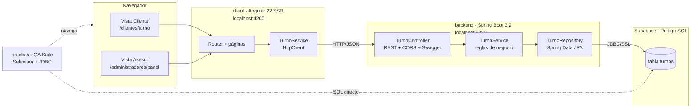
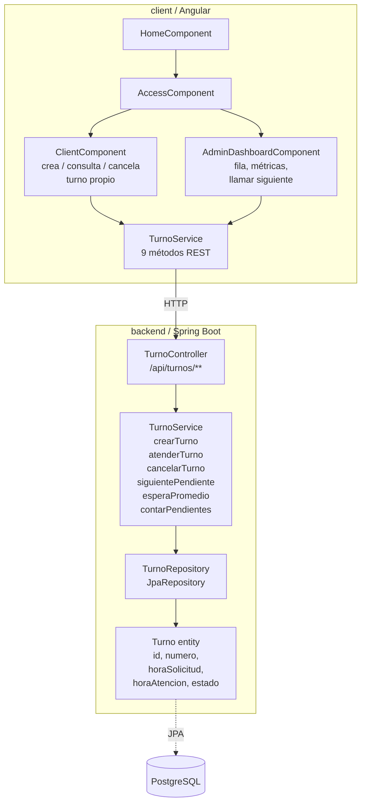
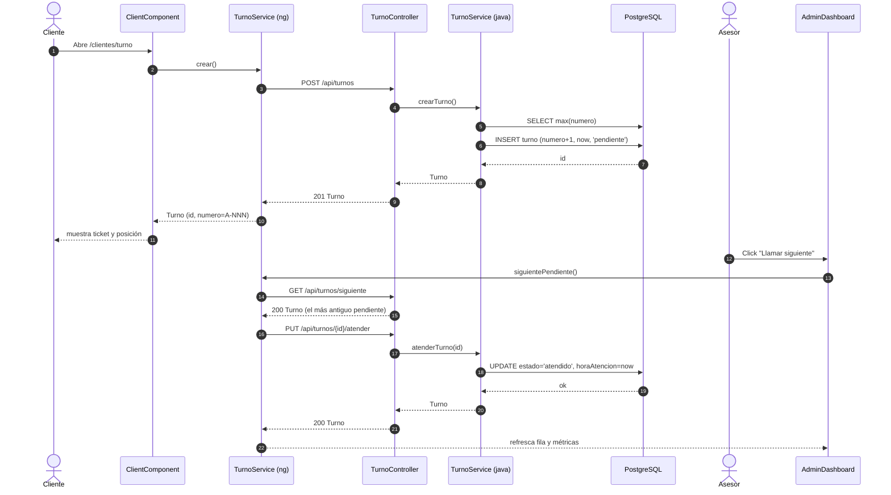
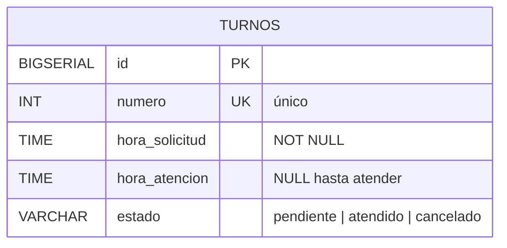
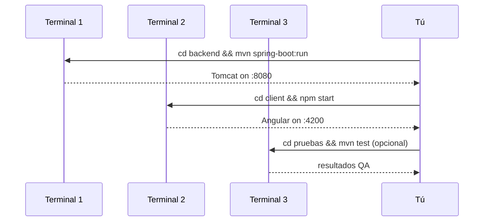
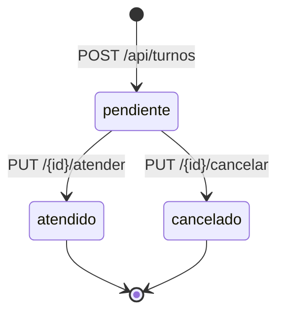

# turnos-app · Fila Virtual de Turnos

Sistema de gestión de turnos de atención en ventanilla con tres módulos: **backend** Spring Boot (Java 17 + PostgreSQL/Supabase), **client** Angular 22 con SSR (vistas cliente y asesor), y **pruebas** suite de QA (Selenium E2E + validaciones directas en BD).

---

## 1. Arquitectura general



### Diagrama de componentes (capas)



### Flujo "cliente pide turno y asesor lo atiende"



### Modelo de datos



Reglas enforced en la BD (ver [`pruebas/src/test/resources/sql/schema.sql`](pruebas/src/test/resources/sql/schema.sql)):

- `UNIQUE (numero)` — no se puede repetir número de turno (SQLState `23505`).
- `CHECK (estado <> 'atendido' OR hora_atencion IS NOT NULL)` — no se puede marcar atendido sin hora de atención.
- `CHECK (hora_atencion IS NULL OR hora_atencion >= hora_solicitud)` — no se puede atender antes de solicitar (SQLState `23514`).

---

## 2. Estructura del repositorio

```
turnos-app/
├─ README.md                    ← este archivo
├─ backend/                     ← API Spring Boot
│  ├─ pom.xml
│  ├─ postman/
│  │  └─ TurnosAPI.postman_collection.json
│  └─ src/main/
│     ├─ java/com/assessment/turnos/
│     │  ├─ TurnosApplication.java
│     │  ├─ controller/TurnoController.java
│     │  ├─ model/Turno.java
│     │  ├─ repository/TurnoRepository.java
│     │  └─ service/TurnoService.java
│     └─ resources/application.properties
├─ client/                      ← Frontend Angular 22 SSR
│  ├─ package.json
│  ├─ angular.json
│  └─ src/
│     ├─ main.ts
│     ├─ index.html
│     └─ app/
│        ├─ app.config.ts            (provideHttpClient)
│        ├─ app.routes.ts
│        ├─ services/turno.service.ts
│        └─ pages/
│           ├─ home/
│           ├─ access/
│           ├─ client/                (vista del cliente)
│           └─ admin-dashboard/       (panel del asesor)
└─ pruebas/                     ← Suite QA
   ├─ pom.xml
   └─ src/test/
      ├─ java/com/turnos/qa/
      │  ├─ pages/
      │  │  ├─ ClientePage.java
      │  │  └─ AsesorPage.java
      │  └─ tests/
      │     ├─ BaseDeDatosTurnosTest.java      (DB01-DB05)
      │     └─ FilaVirtualTurnosE2ETest.java   (TC01-TC04)
      └─ resources/
         ├─ data/turnos_hoy.csv
         └─ sql/schema.sql
```

---

## 3. Prerrequisitos

| Módulo | Herramienta | Versión mínima | Verificar |
|---|---|---|---|
| **backend** | Java JDK | 17 | `java -version` |
| **backend** | Maven | 3.9+ | `mvn -version` |
| **client** | Node.js | **22.22.3** (o 24.15 / 26) | `node --version` |
| **client** | npm | 10+ | `npm --version` |
| **pruebas** | Java JDK | 17 | `java -version` |
| **pruebas** | Google Chrome | reciente | para Selenium (WebDriverManager baja el driver) |
| **BD** | PostgreSQL / Supabase | — | credenciales en `application.properties` |

> ⚠️ Si tu Node es menor a `22.22.3`, Angular 22 rechaza arrancar. Actualiza con el instalador LTS de https://nodejs.org/ o con `winget install OpenJS.NodeJS.LTS`.

---

## 4. Cómo correr cada módulo

### 4.1 Backend (`backend/`)

```powershell
cd backend
mvn spring-boot:run
```

Logs esperados:
```
HikariPool-1 - Start completed.
Tomcat started on port 8080
Started TurnosApplication in X seconds
```

Comprobaciones:
- **Swagger UI** → http://localhost:8080/swagger-ui.html
- **OpenAPI JSON** → http://localhost:8080/v3/api-docs
- **Prueba rápida** → http://localhost:8080/api/turnos (debería devolver `[]` o la lista actual).

#### Configuración de BD

Editable en [`backend/src/main/resources/application.properties`](backend/src/main/resources/application.properties):

```properties
spring.datasource.url=jdbc:postgresql://db.<TU-PROYECTO>.supabase.co:5432/postgres?sslmode=require&stringtype=unspecified
spring.datasource.username=postgres
spring.datasource.password=<TU-PASSWORD>
```

**Importante:**
- `?sslmode=require` → Supabase exige SSL.
- `&stringtype=unspecified` → necesario si la columna `estado` está como ENUM nativo en Postgres (deja que el servidor infiera el tipo).
- No commitees la contraseña real; usa variable de entorno (`${DB_PASSWORD:default}`) si vas a subir el archivo.

#### Compilar / empaquetar

```powershell
cd backend
mvn clean package                       # genera target/turnos-0.0.1-SNAPSHOT.jar
java -jar target/turnos-0.0.1-SNAPSHOT.jar
```

### 4.2 Frontend (`client/`)

```powershell
cd client
npm install          # solo la primera vez (~1-2 min)
npm start            # equivalente a `ng serve`
```

Abre **http://localhost:4200**. Si usas una URL distinta, actualiza el `@CrossOrigin` del controller y la constante `baseUrl` del `TurnoService` de Angular.

Build de producción:
```powershell
cd client
npm run build        # genera dist/client/
```

Las vistas disponibles son:

| Ruta | Qué hace |
|---|---|
| `/` | Landing (`HomeComponent`) |
| `/clientes` | Portal de acceso para clientes |
| `/clientes/turno` | Crea un turno (POST) y muestra el ticket + posición en fila |
| `/administradores` | Portal de acceso para asesor |
| `/administradores/panel` | Fila pendiente, métricas, botón "Llamar siguiente" |

### 4.3 Suite de pruebas QA (`pruebas/`)

Requiere el **backend corriendo** (para las pruebas E2E, también el **frontend**).

```powershell
cd pruebas

# A) Solo pruebas de BD (contra Supabase / PostgreSQL)
mvn test -Dtest=BaseDeDatosTurnosTest `
  -Ddb.url="jdbc:postgresql://db.<TU-PROYECTO>.supabase.co:5432/postgres" `
  -Ddb.user="postgres" `
  -Ddb.password="<TU-PASSWORD>"

# B) Solo pruebas E2E Selenium (con backend + front levantados)
mvn test -Dtest=FilaVirtualTurnosE2ETest -Dbase.url=http://localhost:4200
mvn test -Dtest=FilaVirtualTurnosE2ETest -Dheadless=true -Dbase.url=http://localhost:4200   # CI

# C) Todo
mvn clean test `
  -Ddb.url="jdbc:postgresql://db.<TU-PROYECTO>.supabase.co:5432/postgres" `
  -Ddb.user="postgres" `
  -Ddb.password="<TU-PASSWORD>" `
  -Dbase.url=http://localhost:4200
```

Ver detalle de cada caso en [pruebas/README.md](pruebas/README.md).

---

## 5. Levantar todo el stack (orden recomendado)

Abre **tres terminales**:



Resumen:

```powershell
# Terminal 1 — Backend
cd C:\Users\mater\Desktop\turnos-app\backend
mvn spring-boot:run

# Terminal 2 — Frontend
cd C:\Users\mater\Desktop\turnos-app\client
npm start

# Terminal 3 — QA (opcional)
cd C:\Users\mater\Desktop\turnos-app\pruebas
mvn test
```

---

## 6. API REST — referencia rápida

Base: `http://localhost:8080/api/turnos`

| Método | Path | Descripción | Respuesta |
|---|---|---|---|
| `GET` | `/` | Listar todos (orden ASC por `horaSolicitud`) | `200 Turno[]` |
| `GET` | `/{id}` | Buscar por id | `200 Turno` · `404` |
| `GET` | `/estado/{estado}` | Filtrar por estado | `200 Turno[]` |
| `GET` | `/siguiente` | Próximo turno pendiente | `200 Turno` · `404` |
| `GET` | `/espera-promedio` | Promedio de espera en minutos | `200 number` |
| `GET` | `/pendientes/count` | Cantidad de pendientes | `200 number` |
| `POST` | `/` | Crear turno (sin body) | `201 Turno` |
| `PUT` | `/{id}/atender` | Marcar como atendido | `200 Turno` · `400` |
| `PUT` | `/{id}/cancelar` | Marcar como cancelado | `200 Turno` · `400` |

### Modelo `Turno` (JSON)

```json
{
  "id": 12,
  "numero": 11,
  "horaSolicitud": "14:32:17",
  "horaAtencion": null,
  "estado": "pendiente"
}
```

- `estado` ∈ `pendiente | atendido | cancelado` (strings minúscula).
- `horaAtencion` → `null` hasta que el estado sea `atendido`.
- El body del `400` es **texto plano**, no JSON.

### Ejemplos de respuesta

**`GET /api/turnos`** → `200 OK`
```json
[
  { "id": 1, "numero": 1, "horaSolicitud": "08:02:00", "horaAtencion": "08:05:00", "estado": "atendido" },
  { "id": 6, "numero": 6, "horaSolicitud": "08:25:00", "horaAtencion": null, "estado": "pendiente" }
]
```

**`GET /api/turnos/espera-promedio`** → `200 OK`
```
8.2
```

**`PUT /api/turnos/99/atender`** (inválido) → `400 Bad Request`
```
Turno no encontrado
```

---

## 7. Reglas de negocio



- Un turno **nace `pendiente`**.
- Solo desde `pendiente` puede pasar a `atendido` o `cancelado`.
- `atender` y `cancelar` sobre un turno ya no-pendiente → `400`.
- `siguiente` siempre toma el **más antiguo pendiente** (orden FIFO por `horaSolicitud`).
- `numero` lo asigna el backend; nunca lo envía el cliente.

---

## 8. Postman

Importa [`backend/postman/TurnosAPI.postman_collection.json`](backend/postman/TurnosAPI.postman_collection.json) en Postman:

- **Import → Upload Files → selecciona el JSON**.
- Variables ya configuradas: `{{baseUrl}}` (= `http://localhost:8080`) y `{{turnoId}}`.
- El request `Crear turno` guarda automáticamente el `id` creado en `{{turnoId}}` → los `PUT /atender` y `PUT /cancelar` lo reusan sin que lo copies.

Flujo de prueba sugerido: `Crear turno` → `Listar todos` → `Atender turno` → `Espera promedio`.

---

## 9. Troubleshooting

| Síntoma | Causa probable | Fix |
|---|---|---|
| `node --version` < 22.22.3 | Node viejo para Angular 22 | `winget install OpenJS.NodeJS.LTS` o nvm |
| Backend `500` al hacer `POST /api/turnos` con `column estado is of type estado_turno but expression is of type character varying` | Columna `estado` es ENUM en Supabase | Añadir `&stringtype=unspecified` al JDBC URL |
| Backend `FATAL: no pg_hba.conf entry ... SSL off` | Supabase exige SSL | Añadir `?sslmode=require` al JDBC URL |
| Backend `FATAL: password authentication failed` | Contraseña mal | Revisar/rotar en Supabase |
| Backend `UnknownHostException` | DNS / IPv6 bloqueado | Usar Session pooler de Supabase (puerto 6543) |
| Front `CORS error` en consola | Angular no está en `:4200` o el back cambió el origin | Alinear `@CrossOrigin` del controller con el origen real |
| Front en blanco | Error de hidratación / consola rota | F12 → Console; verificar `baseUrl` del service |
| Selenium: `SessionNotCreatedException` | ChromeDriver incompatible | WebDriverManager lo baja; verifica Chrome instalado y actualizado |
| QA DB tests: `SQLState 42P01 relation "turnos" does not exist` | Esquema no cargado | Verifica que `schema.sql` corra antes o que la tabla exista |

### Si el 500 persiste

El backend tiene habilitado `server.error.include-stacktrace=always`. Repite el request con Postman o el browser; el JSON de la respuesta trae el campo `trace` con la causa. Pégalo si pides ayuda.

---

## 10. Siguientes pasos (deuda técnica conocida)

- Mover `baseUrl` del front a `src/environments/environment.ts` para prod.
- Reemplazar `max(numero) + 1` por una secuencia Postgres (`SERIAL`) para evitar carrera.
- Añadir `@Transactional` en los métodos del service que leen + modifican.
- Exponer un endpoint atómico `PUT /api/turnos/llamar-siguiente` (`GET /siguiente` + `PUT /atender` en una transacción).
- Añadir autenticación simple (JWT) para distinguir cliente de asesor.
- Mover credenciales de BD a variable de entorno antes de subir a cualquier repo público.

---

## 11. Contacto / soporte

Si algo falla:

1. Verifica que **backend** y **frontend** estén arriba.
2. Prueba el endpoint desde **Swagger UI** (http://localhost:8080/swagger-ui.html).
3. Mira la consola del backend — el stacktrace está habilitado.
4. Reporta con: endpoint llamado, request completo, response recibido, hora exacta, logs.
